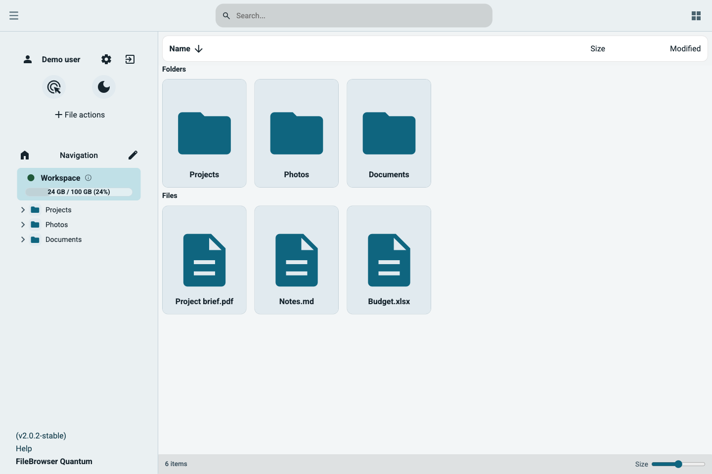
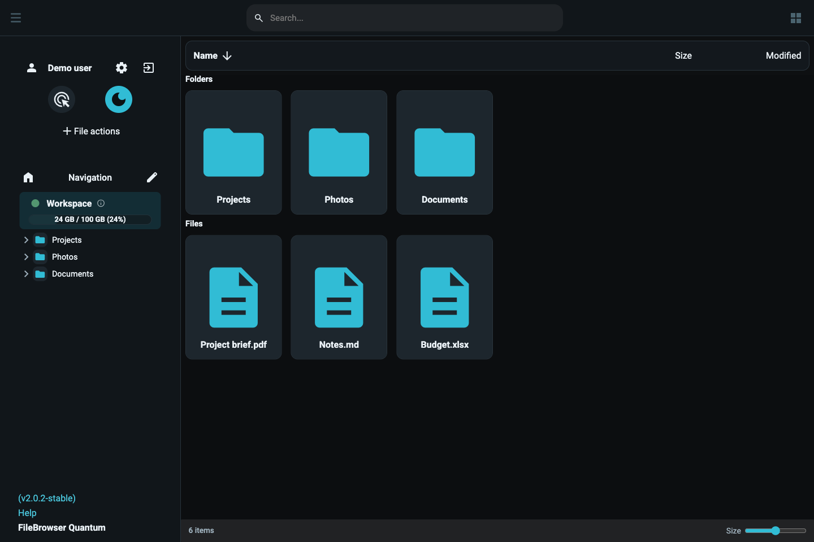
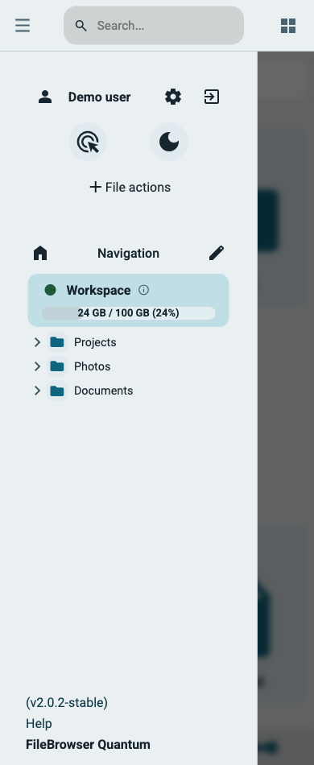
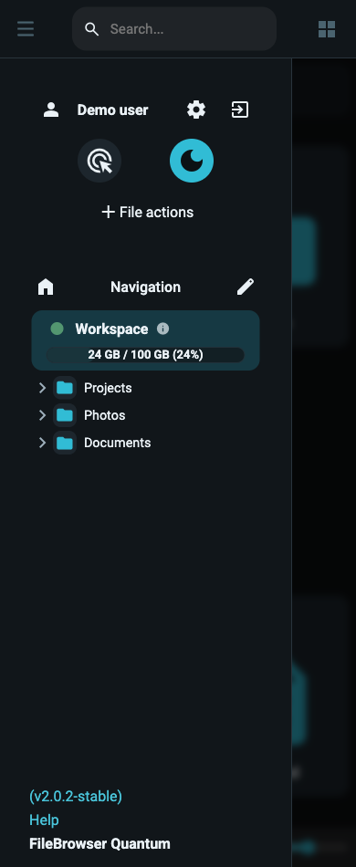

# Interdots Pulse

A calm, compact interface theme for **FileBrowser Quantum v2.0.2-stable**, by Diminix88.

Interdots Pulse combines soft light surfaces and deep petrol dark surfaces with restrained cyan accents. One CSS file follows Quantum's native light/dark toggle and keeps its navigation, sorting, view controls and editor size settings intact.

## Features

- Coordinated light and dark palettes with all six native accent choices.
- Consistent list, compact, icon and gallery views.
- Matching source cards in the sidebar's **Links** and **Navigation** modes.
- Compact, component-specific typography, visible keyboard focus and reduced-motion support.
- Mobile refinements for search filters, dialogs, API tokens, access rules and activity tables.
- Internal table scrolling instead of horizontal page overflow on narrow screens.
- CSS only: no JavaScript, build step, dependencies, external font downloads or tracking added by the theme.

## Screenshots

### Desktop — gallery view

| Light | Dark |
| --- | --- |
|  |  |

### Mobile — open navigation sidebar

| Light | Dark |
| --- | --- |
|  |  |

Screenshots are static, sanitized demo renders of Quantum's actual markup and styles at 1440 × 960 and 390 × 950 CSS pixels. Names, files and storage values are illustrative. They contain no real account or file data and are not captures from a physical phone.

## Installation

You need an existing **FileBrowser Quantum v2.0.2-stable** installation and access to its active `config.yaml`. Back up your configuration before editing it. This theme is not an installer for Quantum.

### 1. Place the stylesheet

Download [interdots-pulse.css](interdots-pulse.css). For Docker, place it in a `themes` directory beside your existing Compose file:

```text
your-installation/
├── compose.yaml
├── data/
│   └── config.yaml
└── themes/
    └── interdots-pulse.css
```

The stylesheet must be a regular, non-empty file readable by the Quantum process. Do not place it in a publicly shared file source merely to serve it: Quantum reads the file from its own filesystem.

### 2. Make it available to Quantum

Add this read-only mount to the **existing service's volumes list**. Adapt the service name to your installation; keep all existing mounts and service settings. This fragment is not a complete Compose configuration.

```yaml
services:
  filebrowser:
    volumes:
      - ./themes/interdots-pulse.css:/themes/interdots-pulse.css:ro
```

| Purpose | Host path in this example | Path inside the container |
| --- | --- | --- |
| Theme | `./themes/interdots-pulse.css` | `/themes/interdots-pulse.css` |
| Existing configuration | `./data/config.yaml` | `/home/filebrowser/data/config.yaml` |

The configuration path shown is the one verified in the local Docker test setup. Use the active configuration mount in your own installation if it differs. The `css` setting below must use the **container path**, not the host path.

For a non-Docker installation, place the file somewhere readable by the Quantum process and use its absolute filesystem path instead. The standalone installation procedure has not been independently tested.

### 3. Register the theme in `config.yaml`

Merge the following into your existing `frontend.styling` section. Preserve other settings and theme entries; do not append a second `frontend`, `styling` or `customThemes` key.

```yaml
frontend:
  styling:
    disableEventThemes: true
    customThemes:
      interdots-pulse:
        description: "Interdots Pulse"
        css: "/themes/interdots-pulse.css"
```

`disableEventThemes: true` prevents seasonal themes from overriding the appearance. It is an instance-wide option; omit it if you want to retain Quantum's seasonal themes. It does not disable the native light/dark toggle.

The theme ID `interdots-pulse` is selectable and does not replace the instance's default theme. Do not rename it to `default` unless you deliberately want a different instance-wide default.

### 4. Restart and select the theme

When adding a new Docker mount, recreate the existing Quantum service using your usual Compose workflow so the mount takes effect. When only CSS or configuration content changes, restart Quantum: **v2.0.2-stable reads custom CSS at startup**. A browser refresh alone does not reload the file on the server.

Open **Settings → Profile**, select **Interdots Pulse** in the theme selector and use Quantum's normal light/dark toggle. If the updated appearance is cached, reload the browser after the server restart.

If the theme is missing or unchanged, check the active configuration, YAML indentation, container-side file path and read permissions. Check Quantum's startup logs for theme-loading warnings. Load only one copy of this stylesheet; do not also inject it through `customCSS`.

The theme registration and read-only mount pattern were checked against a working local Docker installation and the pinned [v2.0.2-stable CSS loader](https://github.com/gtsteffaniak/filebrowser/blob/v2.0.2-stable/backend/pkg/settings/styling.go). See also Quantum's [theme documentation](https://filebrowserquantum.com/en/docs/configuration/frontend/themes/).

## Accent colors and fonts

Quantum's native **Blue, Red, Green, Violet, Yellow and Orange** choices remain available in the profile settings. Blue uses Interdots' teal/cyan palette; the other five retain their native accent tokens. The six choices do not create six separate themes, and the light/dark toggle remains independent.

Inter is the preferred interface font; JetBrains Mono is preferred for code and selected metadata. They are used when locally available, with Quantum/system fallbacks otherwise. No font files are bundled or fetched by this stylesheet. Material Symbols and document/editor font controls remain under Quantum's control.

## Compatibility and limitations

- **Tested application version: v2.0.2-stable only.** No compatibility claim is made for other Quantum versions or the original File Browser project.
- Local browser checks covered 320, 390, 412, 768, 1024 and 1440 CSS-pixel widths across theme development, in light and dark modes. The latest sidebar/admin checks covered 320/390/412/768 px and desktop at 1440 px.
- Browser verification used Chromium/Chrome, including mobile emulation. Physical Samsung Galaxy S23 Ultra/Firefox, Safari and other browsers have not been independently validated.
- A modern browser is required: the CSS uses `color-mix()`, `:has()` and container query units. Older engines may render parts of the theme incorrectly.
- Internal component selectors are version-specific. Recheck the theme before upgrading Quantum; third-party or instance-wide custom CSS may conflict with it.
- Document previews and editor size controls intentionally keep their native sizing. Visible storage values and source availability remain native Quantum data.
- Empty and populated activity results were tested with real local data and filters. Populated API/access table layouts were additionally checked using temporary browser-only sample rows, without creating tokens or access rules.
- Keyboard focus, text wrapping, reduced motion and browser-relative sizing are considered, but this is not a full accessibility certification. Check your own content, zoom level and accent choice.

The CSS uses `--pulse-*` custom properties for Interdots Pulse. The distributed stylesheet is `interdots-pulse.css`.

## Updating

1. Back up the installed stylesheet and review compatibility with your Quantum version.
2. Replace the contents of the mounted `interdots-pulse.css`, keeping the same readable path and theme ID. With a single-file Docker bind mount, update the existing file in place or recreate the service if the file was replaced by a rename.
3. Restart Quantum and reload the browser.
4. Check light/dark, your accent color, sidebar modes and the file/admin views you use. Keep the previous file available for rollback.

No build step or package manager is required.

## Uninstalling

1. Select Quantum's built-in **Default** theme in the profile settings for users who selected Interdots Pulse. Keep a built-in default entry available; its `css` value is an empty string if you define it explicitly.
2. Remove only the `interdots-pulse` entry from `frontend.styling.customThemes`. Restore your previous `disableEventThemes` setting if you changed it for this theme.
3. Remove its CSS mount and recreate the Docker service so the mount is removed; for a non-Docker installation, restart Quantum.
4. Delete the unused CSS file.

## Project and license

Released under the [MIT License](LICENSE). FileBrowser Quantum and its icons, fonts and application code remain subject to their respective licenses. Interdots Pulse is an independent theme and is not an official FileBrowser Quantum product.
